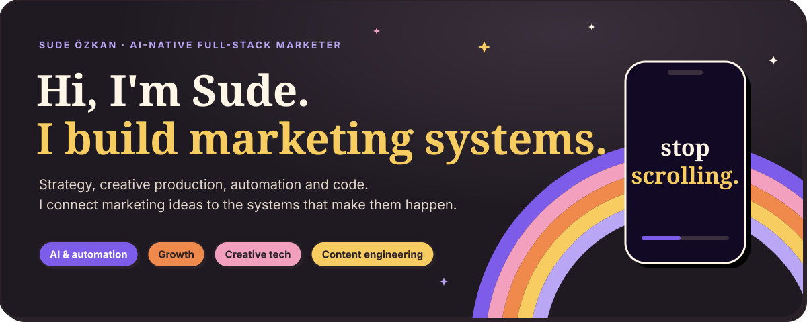
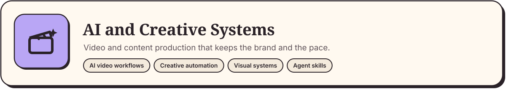
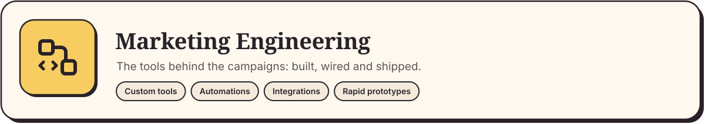
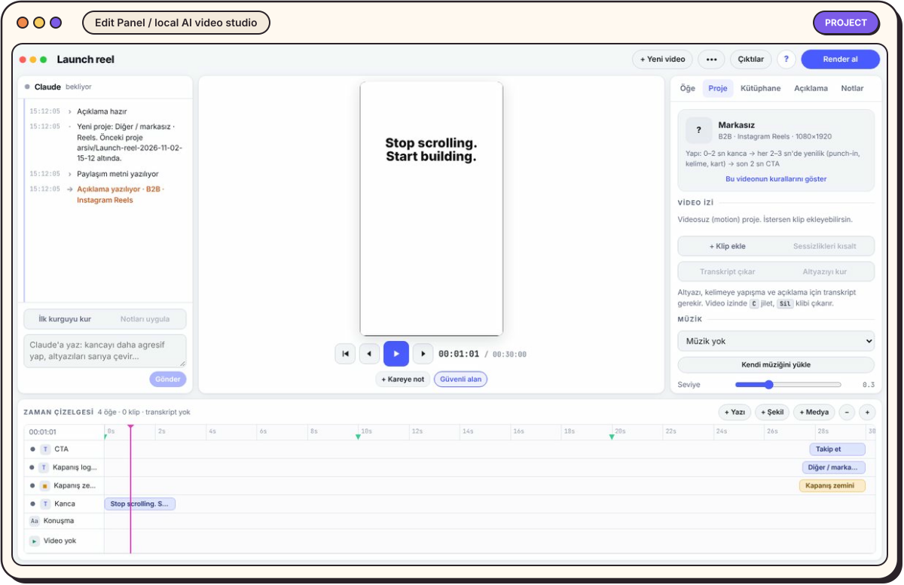
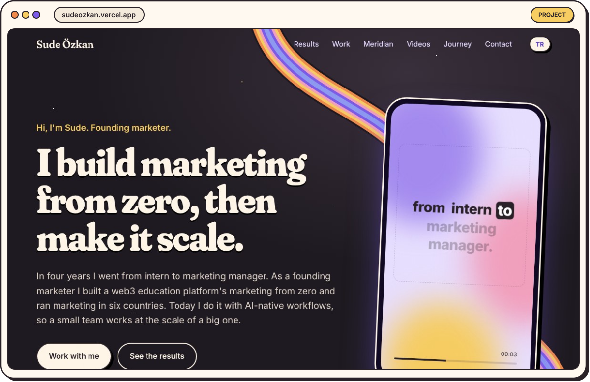
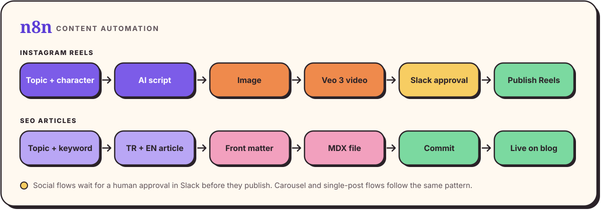
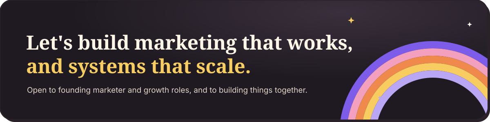

  <a href="https://sudeozkan.vercel.app"><b>Portfolio</b></a> &nbsp;·&nbsp;
  <a href="https://www.linkedin.com/in/sudeozkan/"><b>LinkedIn</b></a> &nbsp;·&nbsp;
  <a href="https://x.com/digitalsude"><b>X</b></a> &nbsp;·&nbsp;
  <a href="https://www.instagram.com/sude.ai/"><b>Instagram</b></a>

I don't just run marketing campaigns. I build the tools, workflows and systems behind them.

I'm a digital marketing manager and founding marketer based in İstanbul and Ankara. I've built marketing from zero for a global developer community and run it across several countries, and I move between strategy, creative production, code and measurement in the same week, often the same day.

## What I build

## Featured projects

### Edit Panel
**A local, AI-assisted video studio that turns brand rules into a first cut.**

- **Problem:** making videos for several brands meant repeating the same rules by hand every time: colors, fonts, safe zones, captions, sound levels.
- **What I built:** a panel where I pick a brand, an audience (B2B or B2C) and a format, then add footage, an image folder or a web page. It trims silences, places word-level captions, builds the first cut from the brand's rules and writes the post copy for each platform. I fine-tune on a timeline and leave notes on frames; Claude applies them.
- **Stack:** Remotion, React, Node.js, Claude Code (headless mode and hooks), mlx-whisper, ffmpeg
- **Status:** private, in daily use. Happy to walk through it on a call.

### Portfolio site
**An illustrated, scroll-driven portfolio where the page itself is a content machine.**

- **Problem:** a CV can't show how I think about attention, pacing and story.
- **What I built:** art direction, copy and the build. A rainbow ribbon pours into a funnel, pipes fill as you scroll and the page ends in a cauldron. Real results sit next to real videos, in English and Turkish.
- **Stack:** HTML, CSS, vanilla JavaScript, SVG, Vercel. Built with Claude Code.
- **Live:** [sudeozkan.vercel.app](https://sudeozkan.vercel.app)

### Content automation with n8n
**Workflows that turn a topic into a published Reel or a bilingual SEO article, with a human approval step.**

- **Problem:** daily social and search content for several brands meant repeating the same steps by hand.
- **What I built:** a Reels flow where AI writes the script from a topic and a character, an image is prepared, Veo 3 makes the video and it goes to Instagram through the Graph API. Carousel and single-post flows follow the same pattern. An SEO flow writes each article in Turkish and English with front matter and ships it to the blog as MDX. Nothing on the social flows publishes until a person approves it in Slack.
- **Stack:** n8n, Veo 3, GPT-4o, Slack, Instagram Graph API, Google Sheets, MDX
- **Status:** private. Happy to walk through it on a call.

### Marketing skills for AI agents
**A playbook I've taught Claude, so every video and post starts from the same standards.**

- **Problem:** the same rules (brand kits, sound levels, safe zones, story structure) were living in my head and in old chats.
- **What I built:** a set of Claude skills covering brand kits, B2B launch video standards, builder-story structure, voice-over and sound rules, and Reels and LinkedIn safe zones. They power Edit Panel. With them, a short video takes me about 15 minutes.
- **Status:** private, because they contain client brand rules.

## Selected work and impact

> Full case studies, with company names and the actual videos, are on [my portfolio](https://sudeozkan.vercel.app).

**AI-powered event content at a global conference**
- **Challenge:** cover a week-long conference while the moments were still fresh.
- **What I built:** a Claude skill for our video workflow: interview pacing, where to cut, subtitles and name cards.
- **Execution:** shot interviews on the ground and edited quick recaps the same day.
- **Outcome:** one of our videos played on the main stage after the foundation's CEO mentioned our team. The most-viewed piece passed 11,400 views on X.

**Web3 event planning and production**
- **Challenge:** bring web3 ecosystems together in person, from small meetups to activations at global conferences.
- **What I built:** an end-to-end event process: plans and run-of-show schedules, budgets with spend and KPI tracking, vendor sourcing and negotiation, and merch made with designers and manufacturers.
- **Execution:** ran event-day operations, staff and contractors on site; secured speaking slots for our team and handled international travel and hotels.
- **Outcome:** hackathons, meetups, side events, VIP dinners and conference activations, each closed with a debrief and a report that improves the next one.

**Founding marketer for a global web3 education platform**
- **Challenge:** build marketing from zero for a new platform that had to work in several countries at once.
- **What I built:** the content and growth engine behind free courses, hackathons, grants and bounties.
- **Execution:** entered Türkiye and India first, then Indonesia, the Philippines and Vietnam. Ran marketing for joint programs with global blockchain foundations; the campaigns I ran helped distribute over $1M to the community.
- **Outcome:** X engagement up 88.5% in six months (171K to 322.6K), LinkedIn engagement doubled, Instagram engagement up 43.7%.

**Community marketing for web3 hubs in Türkiye**
- **Challenge:** give global web3 developer communities a local home in Türkiye.
- **What I built:** each hub's marketing from zero, together with the community: targeted campaigns, meetups, an influencer collaboration and a partnership with a major video platform.
- **Execution:** sized each opportunity, wrote the briefs and ran the process end to end, for three hubs over the years.
- **Outcome:** one hub reached 3,000 followers on X in its first year, another 2,000 in four months.

**Short-form growth for a coding education community**
- **Challenge:** grow a coding education brand, which started out training web2 developers, with organic content only.
- **What I built:** an audience-first Reels format, tested and adapted every week, with AI at the center of the creative process.
- **Execution:** humor and trends for Gen Z, career-change stories, clear calls to apply.
- **Outcome:** 9.9M Instagram reach in one year, Instagram followers from 9K to 90K, LinkedIn followers from 19K to 56K in a year, X followers from 3K to 15K, 345K+ profile visits and 300K+ link clicks.

## My stack

| Function | Tools I actually use |
|---|---|
| **AI & Agents** | Claude Code, custom agent skills, mlx-whisper, ElevenLabs, Higgsfield |
| **Development** | React, Node.js, Remotion, HTML, CSS, JavaScript, MDX, Vercel |
| **Automation** | n8n, Claude Code headless mode and hooks, ffmpeg scripts |
| **Creative Production** | Video editing, motion, storyboards, briefs, word-by-word captions |
| **Analytics & Growth** | Google Analytics, A/B testing, SEO, lead tracking |

## How I work

- **If I explain a rule twice, it becomes a skill.** Build once, reuse on every project.
- **Brand first, then speed.** Every system starts from the brand's own colors, voice and rules.
- **Real numbers only.** If a claim can't be verified, it doesn't ship.
- **The first three seconds work on mute.** Most people watch without sound.
- **AI executes, people decide.** Strategy and judgment stay human.
- **Ship, measure, keep the winner.** The best-performing format becomes the next template.

  <a href="https://sudeozkan.vercel.app"><b>Portfolio</b></a> &nbsp;·&nbsp;
  <a href="https://www.linkedin.com/in/sudeozkan/"><b>LinkedIn</b></a> &nbsp;·&nbsp;
  <a href="https://x.com/digitalsude"><b>X</b></a> &nbsp;·&nbsp;
  <a href="https://www.instagram.com/sude.ai/"><b>Instagram</b></a>

